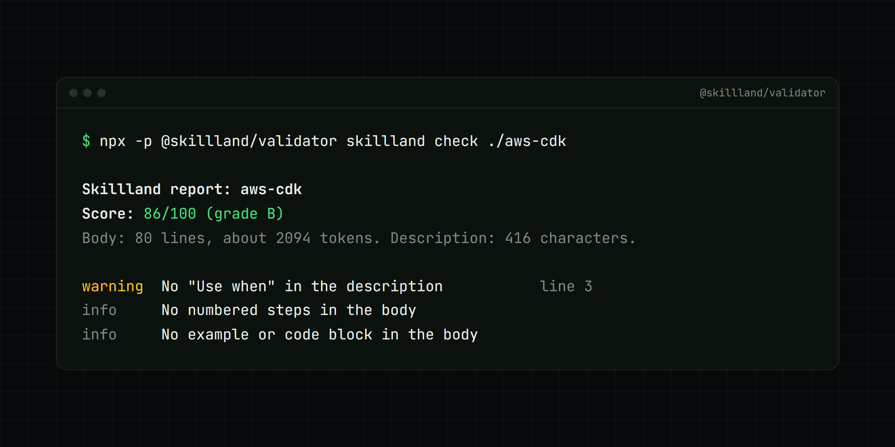

# @skillland/validator

[](https://www.npmjs.com/package/@skillland/validator)
[](https://github.com/skillland-io/skill-validator/actions/workflows/ci.yml)
[](https://www.npmjs.com/package/@skillland/validator)
[](https://github.com/skillland-io/skill-validator/blob/main/LICENSE)
[](https://github.com/skillland-io/skill-validator/blob/main/package.json)

Website: **[skillland.io](https://skillland.io)**. Check a skill in the browser, read every rule with its source, and browse scored public skills.



Lints agent skills (`SKILL.md` folders) for Claude Code, Codex, Cursor and any other agent that follows the [Agent Skills specification](https://agentskills.io/specification).

Every rule quotes, word for word, the sentence of official guidance it relies on: the spec, Anthropic's and Claude Code's docs (including Anthropic's guide to vetting skills for enterprise use), OpenAI's and Cursor's docs, the validation scripts Anthropic and OpenAI ship with their skill creators, NVIDIA's skill docs and SkillEvaluator reference, and the OWASP Agentic Skills Top 10. Where a rule needs a number the sources leave open, such as a length threshold, the rule says so in `ourCall`.

The same rules score the public skills on [skillland.io](https://skillland.io). Each rule has a page at [skillland.io/validate/rules](https://skillland.io/validate/rules).

## Command line

```bash
npx -p @skillland/validator skillland check ./my-skill
```

`<path>` can be a skill folder, a `SKILL.md` file, or a folder that holds many skills. Folders are read whole, so rules about bundled files (broken links, nested references, scripts) run too.

| Option | What it does |
| --- | --- |
| `--format <f>` | `text` (default), `json`, or `github`: an annotation on each finding's line in the pull request, plus a job summary |
| `--json` | Same as `--format json` |
| `--min-score <n>` | Also fail when a skill scores below `n` |
| `--min-area-grade <g>` | Also fail when an area grades below `g`: `B` for every area, `security=A` for one. Repeatable |

Exit codes: `0` every skill passes, `1` a skill has an error or misses a `--min-score` or `--min-area-grade` limit, `2` bad usage.

To check skills on every pull request, use the [Skillland GitHub Action](https://github.com/skillland-io/check-action) ([setup and inputs](https://skillland.io/tools/github-action)):

```yaml
- uses: skillland-io/check-action@v1
  with:
    path: skills
    min-score: 80
    min-area-grade: security=A
```

Or call the CLI in any CI:

```yaml
- run: npx -p @skillland/validator@0.8.0 skillland check skills --format github --min-score 80 --min-area-grade security=A
```

## From your agent

[skillland-io/skills](https://github.com/skillland-io/skills) has three agent skills for Claude Code, Codex and Cursor that run this CLI: `skillland-validate` reports the findings, `skillland-fix` edits the skill and checks again until it scores A, and `skillland-build` writes a new skill and checks it.

```bash
npx skills add skillland-io/skills
```

More on [skillland.io/tools/skills](https://skillland.io/tools/skills).

## Library

```bash
npm install @skillland/validator
```

```ts
import { validateSkill, RULES } from "@skillland/validator";

const report = validateSkill({
  skillMd: fs.readFileSync("my-skill/SKILL.md", "utf8"),
  folderName: "my-skill", // optional: enables the name-matches-folder rule
  files: { "references/api.md": "..." }, // optional: other files, keyed by path inside the folder
});

report.score; // 0-100
report.grade; // "A" to "F"
report.areas; // [{ area: "spec", label: "Specification", score, grade, graded, passed, failed, total, notApplicable }, ...]
report.findings; // [{ ruleId, severity, message, fix, line }]
```

It has one dependency, [`yaml`](https://www.npmjs.com/package/yaml), and runs in Node and in the browser.

`RULES` holds every rule with its title, severity, explanation, a failing and a passing example, and `sources: [{ label, url, quote }]`.

## Scoring

A skill starts at 100. Each failing rule costs 25 points for an error, 8 for a warning and 2 for a suggestion, once per rule however often it fails. A note, such as "calls the network", costs nothing: it points at lines to review, not at a fault. Grades: A from 90, B from 80, C from 70, D from 60, F below. One error on its own gives 75, a C.

Each of the four areas (Specification, Description, Structure and content, Security) also gets a grade, worked out the same way from that area's rules only. An error caps its own area at 59, so the area that has the problem shows F.

The one cap on the overall score: when the frontmatter block is missing or isn't valid YAML, no agent can load the skill and most checks can't run, so the score is capped at 59 (F). Only Specification is graded then; the other areas have `graded: false` and their findings are still listed.

A check with nothing to look at neither passes nor fails. It goes in `report.notApplicable`: the step and example checks on a body of 15 lines or fewer, the body checks on an empty body, the description checks with no description. A note rule that found something goes in `report.noted` and counts as neither passed nor failed. Every rule is in exactly one of the findings, `passed`, `notApplicable`, `noted`, `skipped` (needs the folder) or `blocked` (needs readable frontmatter).

The formula is Skillland's own; no vendor publishes one. It may change between minor versions, which the [changelog](CHANGELOG.md) will say.

## Contributing

New rules and corrections are welcome, as long as each rule is backed by official guidance. See [CONTRIBUTING.md](CONTRIBUTING.md).

## License

MIT. Quotes from third-party documentation are short excerpts, each credited and linked to its source.
